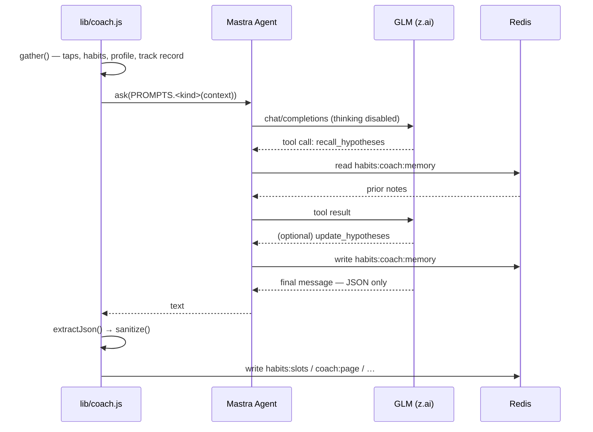

# Mastra in this project

Decision record for how the AI coach is wired today — what Mastra surface we
use, what we hand-roll next to it, and why those choices were made. This is an
inventory of the current code, not a recommendation to lean further into Mastra
or to drop it. The open revisit of that tradeoff is [#66](https://github.com/shaiss/StreamDeckHabitTracker/issues/66).

Runtime deps that load the coach (`package.json` — do not prune for a "leaner"
Vercel install):

| Package | Role today |
|---|---|
| `@mastra/core` `^1.52.1` | `Agent`, `createTool` |
| `@ai-sdk/openai-compatible` `^3.0.14` | z.ai GLM bound to the agent |
| `zod` `^4.4.3` | Tool input/output schemas |

---

## Where it lives

| File | Role | Mastra surface |
|---|---|---|
| [`lib/agent.js`](../lib/agent.js) | Agent instructions, model binding, memory tools | `Agent`, `createTool`, AI-SDK provider |
| [`lib/coach.js`](../lib/coach.js) | Seven passes; `ask()` wraps `agent.generate()` | bare `agent.generate(prompt)` → `.text` |
| [`lib/coach-shape.js`](../lib/coach-shape.js) | Prompt templates + slot sanitizer | **none** (deliberately dependency-free) |
| [`lib/ai.js`](../lib/ai.js) | Direct z.ai `chat()`, `extractJson`, model/key helpers | **none** — used by experiment + parse path |
| [`lib/dataset.js`](../lib/dataset.js) | Captures passes in `{input, output, metadata}` | **none** — shape mimics Mastra Datasets; Redis stores them |
| [`lib/quality.js`](../lib/quality.js) | Rule-based scoring of raw coach output | **none** |
| [`api/experiment.js`](../api/experiment.js) | Model-vs-model replay over captured contexts | **none** — calls `chat()` directly |

Imports used from Mastra today (the whole surface):

```js
import { Agent } from '@mastra/core/agent';
import { createTool } from '@mastra/core/tools';
// …
const res = await coachAgent().generate(prompt); // ask() in lib/coach.js
```

No workflows, no `@mastra/memory`, no scorers package, no observability package,
no structured-output option on `generate`.

---

## The agent

```js
new Agent({
  id: 'coach',
  name: 'Habit Coach',
  instructions: /* personality + reply-shape contract */,
  model: provider(zaiModel()),
  tools: { recallHypotheses, updateHypotheses }
})
```

The instructions carry one framing that matters more than any other line:

> You control up to 4 extra keys — they are your **ONLY** voice to the human.

The slot keys are the coach's entire interface. There is no chat window to
clarify in. Prompt and UX changes are made with that constraint in mind.

`ask()` is a thin wrapper: injectable `generate` so unit tests can exercise the
pass stack without Redis or a network; default is the real agent's `generate()`.
It returns `{ text, engine: 'mastra' }` and throws if the agent returns empty
text. Callers own failure policy (see below).

---

## Decisions that are load-bearing

### 1. `thinking: { type: 'disabled' }` on every chat completion

GLM-5.x are hybrid reasoning models. Without the flag they can spend the whole
token budget thinking and return nothing usable. The agent path injects it via
a custom `fetch` on `createOpenAICompatible` (`zaiFetch` in `lib/agent.js`).
The direct `chat()` path in `lib/ai.js` sets the same field on the request body.

**Never construct the agent provider without that fetch.** There is no
downstream recovery from an all-reasoning empty reply. Cost of discovering this
once: PR #2.

### 2. Memory is two tools + one Redis key, not Mastra memory

Mastra ships memory primitives. We do not use them. The coach runs in Vercel
serverless functions: in-process memory dies with the container, and a pass may
run on a different instance hours later. A full storage adapter would add a
database layer to a project whose state is Redis keys.

Instead, two ordinary Mastra tools over `habits:coach:memory` (via
`lib/store.js`):

| Tool | When | What |
|---|---|---|
| `recall_hypotheses` | start of every pass (instructed) | Prior notes, or `(no notes yet — first session)` |
| `update_hypotheses` | when understanding changes | Overwrites notes (max 2000 chars), stamps `updatedAt` |

The model is told these tools *are* its memory — do not restate notes in the
reply. Persistence survives cold starts, redeploys, and long gaps. Recorded in
[#36](https://github.com/shaiss/StreamDeckHabitTracker/issues/36). Readable at
[`/mind.html`](https://stream-deck-habit-tracker.vercel.app/mind.html) or
`GET /api/mind`.

### 3. Parse + sanitize are hand-rolled; model output is hostile

`ask()` returns raw text. Every pass runs `extractJson()` (`lib/ai.js`) — first
`{` to a *balanced* closing `}` (GLM wraps fences and often trails prose; a
naive last-`}` slice is wrong). Then domain rules run in `sanitize()`
(`lib/coach-shape.js`): habit charset, label ≤12, one emoji, reason ≤160,
`ttlMinutes` 15–720, cap (4 or 12 for coach page), dedupe vs fixed habits and
siblings. Violations drop silently. Faces XML-escape again at render
(`streamdeck-plugin/src/faces.mjs`).

The prompt states the contract as courtesy. Enforcement is the sanitizer.

### 4. Datasets and quality are Redis + rules, Mastra-shaped only in name

Every slots-producing pass appends to `habits:dataset` (cap 300) via
`lib/dataset.js` — exact context, raw pre-sanitize output, live score from
`lib/quality.js`. Items use `{input, output, metadata}` so they *could* move
into Mastra evals tooling without a reshape ([#11](https://github.com/shaiss/StreamDeckHabitTracker/issues/11)).
Nothing in Mastra reads that list today; storage stays Redis for footprint.

Roster and coach-page passes are **not** captured: the corpus and scorers are
front-slot-shaped.

### 5. Experiments bypass the agent on purpose

`GET /api/experiment?run=1&models=…&n=…` replays captured contexts through
`chat()` in `lib/ai.js` with byte-identical `PROMPTS` and scores with
`lib/quality.js`. Going through the agent would introduce tool calls whose
results differ per run (memory mutates). Comparing models means comparing
*models*, not agent trajectories. This is the one intentional exception to
"coach passes are Mastra-routed."

### 6. No silent raw-z.ai fallback on the agent path

An earlier design rescued a failed agent call with a direct API call, which
made a broken agent look like a working one. Framework failures now surface;
each caller chooses how to fail:

| Pass | On failure |
|---|---|
| `reactTo`, `nudgePass` | No-op — already inside `waitUntil(…catch)` |
| `fullSuggest`, `morningPass`, `dailyDigest`, `coachPagePass` | Return `null` → API `502` where applicable |
| `rosterPass` | Queues nothing; never fails the morning keys pass |

`chat()` in `lib/ai.js` still falls back `glm-5.2 → glm-4.7-flash` on
model-level errors when no explicit `model` is passed. The agent path has no
equivalent fallback. Experiment runs pass an explicit `model` so a failure
cannot silently become another model's win.

---

## How a pass runs



---

## The seven passes

All share one agent and one personality; they differ in prompt template and
what they do with the reply. `dailyDigest` builds its prompt inline; the rest
use `PROMPTS` in `lib/coach-shape.js`.

| Pass | Entry point | Trigger | Reply shape |
|---|---|---|---|
| Full refresh | `fullSuggest()` | ✨ Suggest | `{"slots":[…]}` — replaces all four |
| Reactive | `reactTo(entry)` | every tap, 45 s cooldown | `{"change":false}` or `{"slots":[…]}` |
| Morning | `morningPass()` | cron, 10:00 UTC | `{"slots":[…]}` |
| Nudge | `nudgePass()` | rides `/api/slots` poll | `{"nudge":false}` or a single slot def |
| Roster | `rosterPass()` | after morning | `{"proposals":[…]}` — human approval only |
| Coach page | `coachPagePass()` | morning cron + `/api/coachpage` | `{"slots":[…]}` up to 12 → slots 5..16 (#52) |
| Digest | `dailyDigest()` | cron, 03:00 UTC | `{"insight":"…"}` |

Reactive runs in `waitUntil` after `/api/log` answers — a tap never waits on
the model. Its cooldown is claimed in Redis **before** the model call.

---

## Deliberate non-goals (as reflected in code today)

These are skips in the current tree, not a verdict that they must stay skipped.
[#66](https://github.com/shaiss/StreamDeckHabitTracker/issues/66) is the spike
that re-opens each row (lean further into Mastra vs drop Mastra for AI SDK
direct). This doc does not pick a side.

| Skipped / hand-rolled | Current stance in code |
|---|---|
| Mastra structured output on `generate` | `extractJson` + `sanitize` own shaping and domain rules |
| `@mastra/memory` / storage adapters | Two tools over `habits:coach:memory` (#36) |
| Mastra datasets / scorers packages | Redis list + `lib/quality.js` (#11); shape is portable, unused by Mastra |
| Mastra experiment / eval runners | `api/experiment.js` → `chat()` for byte-identical model compare |
| Workflows (`createWorkflow` / suspend-resume) | Async functions + Redis + API approval (`roster`, questions) |
| I/O processors / moderation | Trust boundary is extract → sanitize → XML-escape |
| Observability / AI tracing | Dataset capture is the only production window into passes |
| Agent-side model fallback | Failures surface; only direct `chat()` has glm → flash fallback |

Also deliberate: `lib/coach-shape.js` stays free of `@mastra/core` so CI's
zero-dep unit job can import prompts and `sanitize` without `npm install`.

---

## Testing

```bash
npm test          # unit — prompts, sanitizer, scorer, quality, JSON extraction
npm run test:e2e  # Chromium flows + real plugin against a mock Stream Deck
```

Keep `coach-shape.js` framework-free. Reach the agent only via injectable
`generate` on `ask()`.

---

## Adding another pass

1. Add a prompt template to `PROMPTS` in `lib/coach-shape.js` (no framework imports), unless the prompt is one-off like digest.
2. Document the reply shape in the agent instructions in `lib/agent.js`.
3. Add the entry point in `lib/coach.js`, calling `ask()`.
4. Decide the failure mode explicitly and put it in the failure table above.
5. If it produces front-slot-shaped output, call `capture()` for the dataset.
6. Unit-test the prompt / sanitizer path with an injected `generate`.

---

## Open revisit

[#66](https://github.com/shaiss/StreamDeckHabitTracker/issues/66) inventories
where we under-use or bypass Mastra and hosts competing proposals (adopt more
Mastra surface vs drop `@mastra/core` for the AI SDK directly). Update this
file when the wiring or the rationale of a row above actually changes — not
when a proposal is filed.
